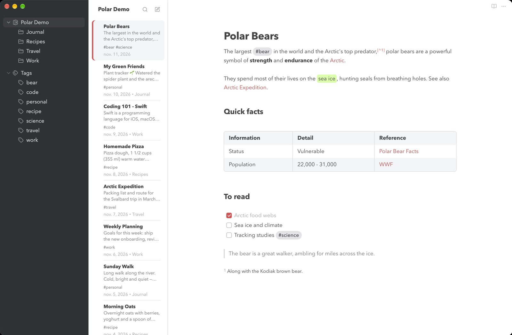
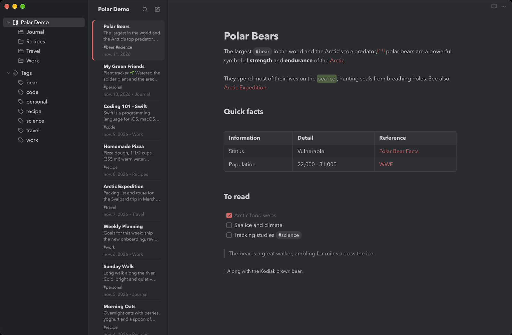

# Polar

A calm, focused Obsidian theme inspired by the [Bear](https://bear.app) notes app.
Light mode follows Bear's *Red Graphite* look, dark mode its *Dark Graphite* look.

Polar is an independent community theme and is not affiliated with or endorsed by Bear or Shiny Frog.

## Features

- Dark graphite sidebar, light note list, distraction-free editor
- Soft red accent for links, bullets, todos and the selected note
- Rounded pill tags, green marker highlights, striped rounded tables
- Quiet markdown syntax and a muted code palette
- No tab bar, status bar or vault footer: just your notes (each can be brought back with Style Settings)
- Light and dark mode

## Recommended setup

For the three-column layout (tags · notes · editor), install the
[Notebook Navigator](https://community.obsidian.md/plugins/notebook-navigator) plugin
from the community plugins ([source on GitHub](https://github.com/johansan/notebook-navigator)) and
place it in the left sidebar. Polar styles it out of the box. Suggested settings:

- **Notebook Navigator**: note grouping *none*, task progress off, note counts off;
  toolbar: no navigation buttons, list only *search* and *new note*.
  Quickest way: download [`notebook-navigator-settings.json`](notebook-navigator-settings.json) and load it via
  *Settings → Notebook Navigator → Import and export settings → Import from file*.
  Note: importing resets any Notebook Navigator setting not in this file to its default.
- **Obsidian → Editor**: readable line length on, backlinks in document off
- **Obsidian → Appearance**: show inline title on
- **Style Settings** (optional): to bring back the status bar, tab bar, vault footer or note header controls, see [below](#bringing-hidden-elements-back-style-settings)

## Notes

Polar hides the editor tab bar, the status bar, the vault footer and the sidebar tab row.
Open settings with <kbd>⌘</kbd>/<kbd>Ctrl</kbd> + <kbd>,</kbd> and other panes from the command palette.

### Bringing hidden elements back (Style Settings)

Want some of it back? Install the [Style Settings](https://github.com/mgmeyers/obsidian-style-settings)
plugin from the community plugins and open *Settings → Style Settings → Polar → Interface*:

| Setting | Options |
|---|---|
| **Status bar** | *Hidden* (default), *Show on hover* (fades in when you point at the bottom-right corner) or *Visible* |
| **Show tab bar** | Brings back the tab bar above the editor; it becomes the window's drag area again |
| **Show vault footer** | Vault switcher, help and settings, shown as a compact two-line block in the bottom-left corner of the tag column, so both columns still run to the bottom of the window |
| **Show note title and navigation buttons** | Back/forward buttons and the file title in the note header |

Without Style Settings, or with everything left at its default, Polar looks exactly as in the screenshots.

## License

MIT
